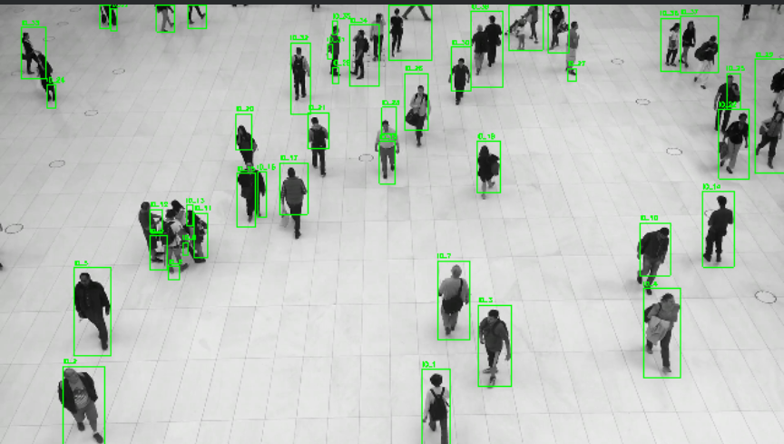
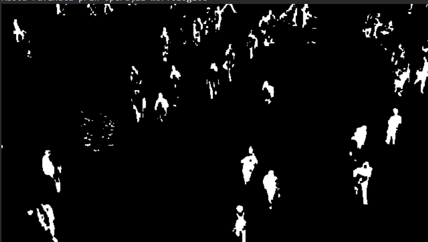

# Crowd-density-estimation

Real-time human detection, tracking, and crowd density estimation from video streams built with **Python** and **OpenCV**. The system uses **MOG2** background subtraction, morphological noise reduction, and spatial analysis to handle occlusion and perspective distortion.

---

## Results

| Pedestrian Detection | Density & Motion Analysis |
| :---: | :---: |
|  |  |
| *Head/body bounding boxes & counts* | *Foreground motion mask & density level* |

---

## Pipeline

1. **Preprocessing:** Grayscale conversion and Gaussian blur ($5 \times 5$) to filter sensor noise.
2. **Foreground Segmentation:** MOG2 background subtraction ($B(x,y,t)$ modeled over the first 60 frames) to isolate moving objects:
   $$\vert{}I(x,y,t) - B(x,y,t)\vert{} > \tau$$
3. **Morphological Refinement:** 
   * **Closing:** Merges separated anatomical regions (head, body, legs).
   * **Opening / Erosion:** Removes small artifacts, reflections, and camera noise.
4. **Blob Analysis & Density Metric:**
   * **Distance Transform:** Separates overlapping bodies in dense clusters.
   * **Group Rectangles:** Eliminates duplicate bounding boxes around the same individual.
   * **Pixel-wise Ratio:**
     $$\text{Density} = \left( \frac{\text{White Pixels}}{\text{Total Pixels}} \right) \times 100$$

---

## Tech Stack

* **Language:** Python 3.x
* **Libraries:** OpenCV (`cv2`), NumPy, Matplotlib
* **Environment:** Jupyter Notebook / Google Colab

---

## Setup & Execution

1. Clone repo:
   ```bash
   git clone [https://github.com/claudiajakab22/Crowd-density-estimation.git](https://github.com/claudiajakab22/Crowd-density-estimation.git)
   cd Crowd-density-estimation
   ```
Install dependencies:
   ```bash
   pip install -r requirements.txt
```
Run the notebook:
   -Place video1.mp4 in the project root.
   -Open and execute crowd_density_estimation.ipynb.
